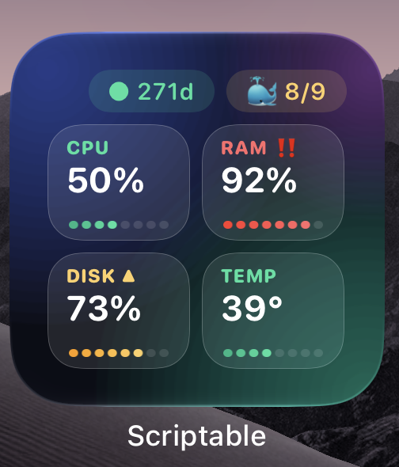
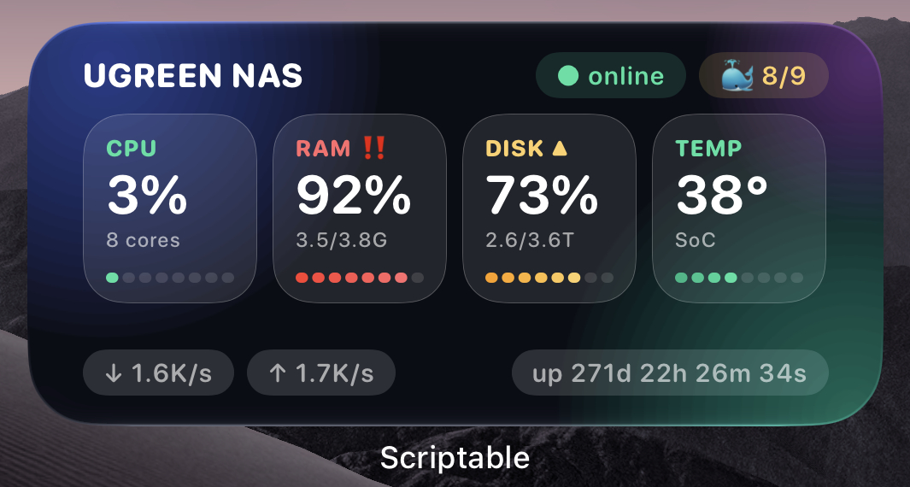
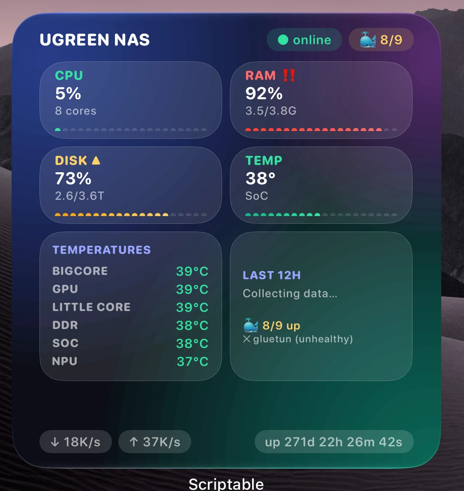

# UGREEN NAS Widget for Scriptable

**Version 1.0.0**

An iOS widget that shows live stats from a UGREEN NAS (UGOS): CPU, RAM, disk usage, temperatures, uptime, network speed and running Docker containers. It comes in three home-screen sizes, small (2×2), medium (4×2) and large (4×4), plus lock-screen widgets. It uses frosted glass tiles and segmented meters that turn amber and red as load rises.

It reads data from [Glances](https://nicolargo.github.io/glances/), a small monitoring tool you run in Docker on the NAS. UGOS has no documented stats API, so Glances is the bridge.

| Size | What you get |
|---|---|
| Small | Uptime and Docker pills, plus CPU / RAM / DISK / TEMP tiles |
| Medium | Online status and Docker pills, four tiles with detail lines (cores, used/total), footer with network speed and full uptime (`up 271d 22h 25m 18s`) |
| Large | Same tiles in a 2×2 grid, a temperature list, a 12-hour CPU/RAM trend graph, a Docker summary listing containers that are down, footer with network speed and uptime |
| Lock screen | Circular gauge (CPU, RAM, disk or temp), a three-line rectangular widget, and a one-line inline widget |

**Features**
- **Works offline-ish:** if the NAS can't be reached, the widget shows the last good reading with a `⏱ 12m ago` pill instead of going blank.
- **Alert marks as well as colours:** `▲` at the warning level and `‼` at critical, so warnings still show when iOS strips colour from tinted or clear widgets.
- **Per-widget settings** through the widget's Parameter field, so you can run several widgets for different NAS units without editing the script.
- **Tap links** for the disk tile and Docker pill (see [Configuration](#configuration)).

## Screenshots

| Small (2×2) | Medium (4×2) |
|---|---|
|  |  |

**Large (4×4)**



> Tested on a UGREEN DH2300 (ARM). Sensor names differ between models; see [Troubleshooting](#troubleshooting).

## Requirements

- A UGREEN NAS running UGOS with the **Docker** app installed (App Center)
- An iPhone or iPad with [Scriptable](https://scriptable.app) installed
- For use away from home: [Tailscale](https://tailscale.com) on both the NAS and your phone (free for personal use)

## 1. Run Glances on the NAS

SSH into the NAS (enable it under **Control Panel → Terminal**), or use the Docker app's **Project** page with the equivalent compose file below.

```bash
sudo docker run -d --name glances --restart unless-stopped \
  -p 61208:61208 \
  -e GLANCES_OPT="-w" \
  --pid host \
  -v /volume1:/volume1:ro \
  -v /var/run/docker.sock:/var/run/docker.sock:ro \
  nicolargo/glances:latest-full
```

- Change `/volume1` if your storage pool is mounted somewhere else (run `df -h` to check).
- The `docker.sock` line is optional. Without it the widget works but can't show the Docker container count.

Compose equivalent:

```yaml
services:
  glances:
    image: nicolargo/glances:latest-full
    container_name: glances
    restart: unless-stopped
    pid: host
    ports:
      - "61208:61208"
    environment:
      - GLANCES_OPT=-w
    volumes:
      - /volume1:/volume1:ro
      - /var/run/docker.sock:/var/run/docker.sock:ro
```

Check it works by opening `http://NAS-IP:61208/api/4/cpu` in a browser. It should return JSON.

## 2. Install the widget

1. Open Scriptable, tap **+**, and paste the contents of `ugreen-nas-widget.js`.
2. Edit the settings at the top of the script (see below), mainly `baseUrl`.
3. Tap ▶ to preview. Change `preview` to `"small"`, `"medium"` or `"large"` to see each size.
4. On the home screen, long-press → **+** → **Scriptable**, pick a size and add it. Then long-press the widget → **Edit Widget** and set **Script** to this script.

## 3. Remote access (optional)

1. Install Tailscale on the NAS (App Center, or the `tailscale/tailscale` Docker image) and on your phone, using the same account.
2. Find the NAS's `100.x.y.z` address in the Tailscale app.
3. Set `baseUrl` to `http://100.x.y.z:61208`.
4. Switch off Wi-Fi on your phone and check the widget still loads.

Keep Tailscale connected on the phone (the iOS app has an On-Demand option), otherwise the widget shows **OFFLINE**.

**Don't port-forward Glances to the internet.** It has no strong login. Use Tailscale or another VPN.

## Configuration

All settings are in the `CONFIG` block at the top of the script.

| Setting | Default | What it does |
|---|---|---|
| `baseUrl` | `http://YOUR-NAS-IP:61208` | Address of the Glances server |
| `user`, `pass` | empty | Basic-auth login, only if you started Glances with `--username` / `--password` |
| `name` | `UGREEN NAS` | Title shown on medium and large |
| `volumes` | `["/volume1"]` | Mount points counted in the DISK tile |
| `warn`, `crit` | `70`, `90` | Percent at which meters turn amber and red |
| `tempWarn`, `tempCrit` | `65`, `80` | Temperature (°C) thresholds; the TEMP meter fills toward `tempCrit` |
| `historyHours` | `12` | How much history the large widget's trend graph keeps |
| `metric` | `"cpu"` | What the circular lock-screen widget shows: `cpu`, `ram`, `disk` or `temp` |
| `links` | `{ storage: "", docker: "" }` | URLs opened when you tap the DISK tile or the Docker pill (medium/large). Empty means the Glances page |
| `preview` | `"medium"` | What you see when you run the script inside Scriptable: `small`, `medium`, `large`, `circular`, `rectangular` or `inline` |
| `sizeOverride` | `null` | Real widget sizes in points, if tiles look clipped (see below) |

### Widget Parameter (per-widget settings)

Long-press a widget → **Edit Widget** → **Parameter**, and enter settings as `key=value` pairs separated by semicolons:

```
url=http://100.64.0.5:61208; name=Home NAS; metric=ram; volumes=/volume1,/volume2
```

Supported keys: `url`, `name`, `user`, `pass`, `metric`, `volumes`. These override the values in `CONFIG` for that widget only. Anything stored in a Parameter is visible in your widget settings, so prefer editing the script for passwords.

### Lock-screen widgets

Add a Scriptable widget to the lock screen, choose this script, and pick the circular, rectangular or inline style. Lock-screen widgets are single-colour, so alerts show as `▲` and `‼` marks. For a circular widget showing RAM, set the Parameter to `metric=ram`.

### Drive temperatures (experimental)

Glances doesn't report drive temperatures on every NAS. Its optional SMART plugin can, and the widget reads `/api/4/smart` if it exists. To try it, recreate the container with the plugin enabled and access to the drives:

```bash
sudo docker run -d --name glances --restart unless-stopped \
  -p 61208:61208 \
  -e GLANCES_OPT="-w --enable-plugin smart" \
  --pid host --privileged \
  -v /volume1:/volume1:ro \
  -v /var/run/docker.sock:/var/run/docker.sock:ro \
  nicolargo/glances:latest-full
```

Then check `http://NAS-IP:61208/api/4/smart` returns your drives. This is untested on UGOS and `--privileged` gives the container broad access to the NAS, so only use it if you're comfortable with that. If the endpoint stays empty, the widget simply leaves the drive temperature out.

## Troubleshooting

**Widget says "Setup needed".** `baseUrl` still has the placeholder. Set it in the script or in the widget's Parameter (`url=http://IP:61208`).

**Widget says OFFLINE or "connection refused".** Nothing is answering at `baseUrl`. Check that the container is running (`sudo docker ps`), that the port matches, and, away from home, that Tailscale is on. If the widget has loaded successfully before, it shows the last reading with a `⏱` age pill instead of OFFLINE.

**The trend graph says "Collecting data…".** It needs a few readings, which are recorded each time a widget refreshes (roughly every 5 to 15 minutes). The history is stored inside Scriptable on the phone.

**No Docker pill.** Glances can't see Docker. Recreate the container with the `docker.sock` volume above, then check `/api/4/containers` returns a list. A container whose status is `unhealthy` or stopped is not counted as running.

**No temperature, or the wrong sensor.** Open `http://NAS-IP:61208/api/4/sensors` and look at the labels. The script prefers `soc_thermal`, then labels containing `cpu`, `core`, `package`, `tctl` or `k10temp`. Edit the matching near the top of `getStats()` if yours differ. Drive temperatures only appear if Glances can read them.

**Tiles clipped or leaving gaps.** The script picks widget sizes from your phone's screen height. If your model is missing or wrong, uncomment `sizeOverride` and enter your real sizes:

```js
sizeOverride: { small: [158, 158], medium: [338, 158], large: [338, 354] },
```

**Colours look grey on the home screen.** If you use iOS's tinted or clear widget style, iOS removes widget colours and the background. That comes from the system, not the script.

**The widget doesn't update often.** iOS decides when widgets refresh. The script asks for about every 5 minutes, but it's not guaranteed. Tapping the widget opens the Glances dashboard.

## Privacy

The widget talks only to the address you set in `baseUrl`. Don't commit your real IP, Tailscale address or Glances password if you fork this repo.

## License

MIT © 2026 Matt Aaron Magnaye. See [LICENSE](LICENSE).

## Credits

- [Glances](https://github.com/nicolargo/glances) by Nicolas Hennion
- [Scriptable](https://scriptable.app) by Simon B. Støvring
